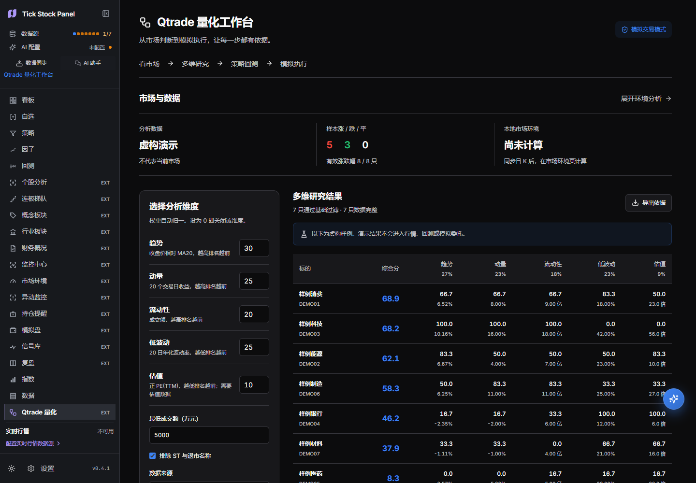

# Qtrade · A 股个人量化工作台

基于 [Tick Stock Panel](https://github.com/shy3130/tick-stock-panel) 的源码派生项目。保留完整 TSP / Tivelo 底座，以简单的“看市场 → 多维研究 → 策略回测 → 模拟执行”流程建立个人量化工作区。

**当前版本：研究/模拟盘 + QMT 官方 SDK 适配、AI 后台监控与自动执行框架。尚未完成实际券商环境验收，不宣称已有真实连接或成交。**



## 首版已有

- **券商与 AI 自动执行**：新增 `/qtrade/live`，自由配置白名单、因子与额度；官方 XtQuant 连接/查询/报撤单适配、限时自动授权、硬风控、持久化幂等、部分成交/撤单/未知状态对账、紧急停止与审计。默认影子模式，无券商环境不报单。详见 [实施计划](docs/qtrade/live-plan.md) 和 [完整操作手册](docs/qtrade/live-operations.md)。

- **市场分析**：样本涨跌家数、数据日期、原有市场环境与主线分析入口；明确标示历史/缺失数据。
- **多维研究**：趋势、动量、流动性、低波动、估值，支持权重、ST 排除与成交额过滤；逐项显示原始值、相对评分和数据覆盖，可导出研究依据。
- **策略与回测**：均线多头、低波动龙头、超跌反弹三个显式安装模板，使用原有策略库、参数/信号配置与 Tivelo 回测。研究权重与交易策略分别配置。
- **模拟自动交易**：模拟账户创建/JSON 导入、回测配置预览、冻结快照、绑定启用、暂停恢复、委托与执行记录。复用原 T+1、费用、涨跌停及幂等账本。
- **没有行情也能试用**：选择“虚构演示”运行研究；虚构证券明确标注，不写行情库、不进入回测或模拟订单。
- **原有能力完整保留**：数据源插件、个股、板块、因子、策略编写、监控、AI 助手、Web 与桌面包装源码。

估值维度需要数据源/扩展提供标准 `pe_ttm`；缺失时不计算综合分，不会偷偷补零。首次安装没有自动同步真实行情，也没有附带 API Key。

## Windows 快速运行

需要 Python 3.12、Node.js 20+、npm 和 [uv](https://docs.astral.sh/uv/)。首次运行需要联网安装依赖。

```powershell
git clone https://github.com/Xiaoc7r/Qtrade.git
cd Qtrade
.\start-qtrade.ps1
```

也可以双击 `start-qtrade.cmd`。脚本安装锁定依赖、构建前端，然后只监听本机地址。默认入口：[http://127.0.0.1:3028/qtrade](http://127.0.0.1:3028/qtrade)。端口冲突会停止提示，不结束其他程序。

依赖和前端已准备好时：

```powershell
.\start-qtrade.ps1 -SkipInstall -SkipBuild
# 或改端口
.\start-qtrade.ps1 -Port 3030
```

默认使用当前仓库的 `data/`，与已安装 TSP 独立。不要将桌面 TSP 的数据目录直接共用给两个同时运行的实例。`Ctrl+C` 停止服务。原桌面打包和 Docker 构建入口仍保留，详见 [上游说明](README.upstream.md)；上游现成 Docker 镜像不包含 Qtrade 新功能。

## 第一次使用

1. 完成原 TSP 首次向导，在侧栏快捷入口打开 **Qtrade 量化工作台**。
2. 没有数据时先选“虚构演示”体验；研究真实市场时，先配置数据源并在“数据”同步日 K，再切回“本地已同步行情”。
3. 调整维度与权重，运行分析。查看日期、覆盖率与原始指标，而不只看综合分。
4. 安装一个策略模板，进入“回测”，选择同名策略，配置指标、信号、区间、仓位、费用与风控；做样本外验证。
5. 创建模拟账户，在工作台下方选择账户，点击“绑定参数快照”，优先使用已验证的回测候选/报告，预览后显式启用。
6. 到“完整模拟盘”核对委托、成交、持仓、资金和执行记录；暂停策略不自动撤销已存在委托。

模拟账户配置示例（不是券商登录信息）：

```json
{
  "mode": "paper",
  "account_id": "my_paper",
  "name": "我的模拟账户",
  "initial_cash": 100000,
  "commission_pct": 0.00025,
  "stamp_tax_pct": 0.0005,
  "slippage_bps": 5
}
```

导入只创建账户配置，不迁移成交/持仓。相同标识拒绝覆盖；不接受实盘模式或密码/Token 字段。费率只是模拟参数，需按自己的实际成本调整。

## 源码、研究与验证

- [架构、计算口径、功能边界与下一阶段](docs/qtrade/architecture.md)
- [REA 对本机 TSP 的实测证据摘要与开源量化选型](docs/qtrade/research.md)
- [本次验证记录](docs/qtrade/verification.md)
- [上游原 README](README.upstream.md)、[二次开发契约](docs/secondary-development.md)、[模拟执行完整限制](backend/app/custom/paper_execution/README.md)

新增代码集中在 `backend/app/custom/qtrade/`、`frontend/src/custom/qtrade/`，通过原扩展加载器接入。没有新增第二套行情、回测或成交账本。

```powershell
cd backend
$env:PYTHONUTF8='1'
uv sync --extra dev --frozen
uv run pytest tests/test_qtrade.py tests/test_paper_trading.py tests/test_paper_execution_extension.py tests/test_paper_api.py tests/test_extensions.py tests/test_strategy_registry.py -q
cd ../frontend
npm exec --yes --package=pnpm@9.10.0 -- pnpm install --frozen-lockfile
npm exec --yes --package=pnpm@9.10.0 -- pnpm build
```

## 实盘进度

QMT/XtQuant 已实现代码适配：使用已登录的本机客户端，账户与 userdata 路径从本机环境读取，不保存券商密码。支持多维研究、受限结构化 AI 风险意见、后台监控与风控后自动报单。模型不能扩大白名单、上调风险额度或直接生成任意订单。

真实启用还需要券商权限、兼容 SDK、完整风险配置、券商仿真验收、本机环境开关与进程限时授权。当前开发机尚不具备这些券商条件，所以软件测试不代表实盘接入验收。XTP/VeighNa 仍是候选，未实现第二个券商通道。

## 来源与许可

上游源码快照：`shy3130/tick-stock-panel@ef5d6382fa3ffd8d2e04f1240043cdb72ac8d06f`，版本 0.4.1。保留 [MIT LICENSE](LICENSE) 与各子包许可；本项目不是 TSP 官方发行版。Qtrade 新增代码沿用 MIT。AKShare、Qlib、vn.py 等仅完成一手资料调研，尚未集成；详见研究文档。
