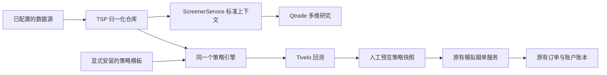

# Qtrade 首版架构与边界

Qtrade 是 TSP 源码派生版本。本次基于上游 `ef5d6382fa3ffd8d2e04f1240043cdb72ac8d06f`（0.4.1）导入完整源码，保留原 MIT 许可证和各包的许可文件。没有将桌面用户数据复制进仓库。

## 数据与执行

新增路由 `/qtrade` 和 `/api/custom/qtrade/*` 通过现有扩展注册发现。核心入口只增加统一 API 方法、类型与 Query key，保留原页面。没有新行情采集线程、第二套回测或第二套交易账本。

## 分层分析

1. 市场层：读取本地最新样本日期、涨跌家数；市场环境使用原有 `/api/regime/latest`，独立显示其日期。不是全市场样本时不能声称覆盖全市场；数据日期为今日也不意味着逐笔实时。
2. 因子层：趋势 `close / ma20 - 1`、20 日动量、成交额、20 日年化波动率、正 PE(TTM)。涨跌幅和收益均为小数比率，前端显式乘 100；成交额为人民币元。趋势使用研究价格，不作为实际成交价格。
3. 样本层：先排除 ST/退市名称、过滤成交额；所有正权重维度必须齐全且有限。PE 非正无效，波动率不能为负。缺失维度不补零、不自动删权重。缺少名称时不能证明排除 ST，因此停止筛选。
4. 排序层：对同一个完整样本按每项因子做百分位排名，平均排名处理并列；单样本为 50 分；再按归一化权重相加。同分按证券代码稳定排序。相对分数不是收益概率。
5. 决策层：研究权重不会自动变成交易规则。用户可安装均线多头、低波动龙头、超跌反弹模板，在原回测页选择同名策略，修改指标、买卖点、仓位和风控，再将通过验证的配置绑定到模拟盘。

## 账户与执行边界

支持新建模拟账户或导入配置 JSON；仅接受 `mode=paper`、账户标识、名称、初始资金与模拟费率。未知字段、无穷数、实盘模式拒绝；重复标识拒绝覆盖。它不是券商账号登录或成交/持仓迁移。

策略模板复用原源码安全校验、唯一保存入口、引擎 reload 和缓存失效。再次安装不覆盖用户已编辑的同 ID 策略。关闭扩展不删除已安装策略、账户或历史记录。

策略执行复用 `paper_execution`：收盘数据确认后，生成下一交易日开盘模拟单；保留 T+1、手数、费用、涨跌停、资金和席位限制、重启去重与逐账户暂停。暂停跟单不撤销已有订单。完整差异和限制以 [原执行说明](../../backend/app/custom/paper_execution/README.md)为准。

QMT 官方 SDK 适配、AI 后台监控、风控与持久化执行已在 `backend/app/custom/qtrade/live/` 实现，入口为 `/qtrade/live`。模拟盘账本保持原路径；实盘数据库只存意图、审计与券商回报副本。XTP 仍为候选。当前尚无券商权限或 SDK 环境，未完成实际券商验收；不能靠网页输入一个账号就承诺接通交易。实现边界见 [实盘操作手册](live-operations.md)。

## 缓存与性能

研究结果按完整配置保存在独立 React Query key；运行按钮发起读取，不增加后台扫描循环。底层行情和指标复用 ScreenerService / repository 的原缓存。修改权重后显示“尚未应用”，不会拿新标签解释旧结果。策略安装失效模板、策略列表、筛选策略与策略池查询；账户导入失效原账户列表。执行面板继续复用原查询键和轮询。

## 后续开发顺序

先用真实数据源积累可回放样本，核对数据完整性与复权，再做滚动样本外检验和模拟盘持续对账。接着扩充基本面/行业/资金因子及 point-in-time 公告日期，最后按具体券商实现真实交易通道。当前规则解释不调用 LLM；原 TSP AI 助手仍可由用户配置使用，不能把生成文本直接当作执行权限。
